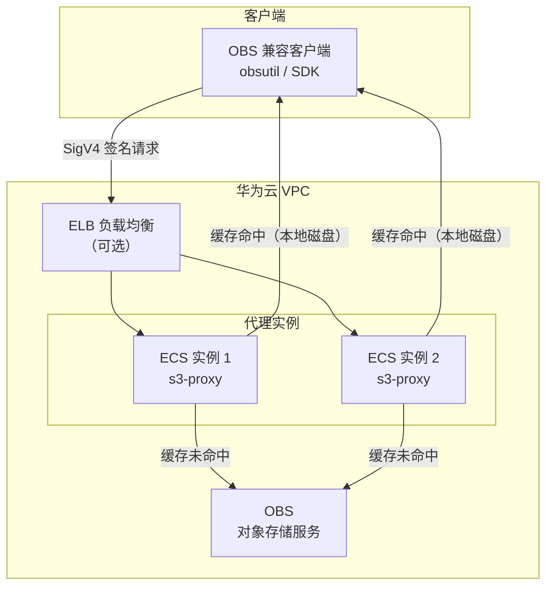

# S3 透明缓存代理（S3 Hybrid Cache Proxy）


## 1. 简介

基于华为云 ECS 部署的高性能 S3 透明缓存代理，加速 OBS（对象存储服务）访问。提供智能多层缓存、流式架构和全面的观测能力，客户端通过 OBS 的 S3 兼容接口接入，业务协议零改动。

**核心能力**：

- **透明认证**：代理不存储凭据，直接透传客户端 SigV4 签名请求到 OBS，保持完整的 IAM 策略控制
- **本地磁盘缓存**：代理实例通过本地磁盘缓存数据，避免重复从 OBS 拉取（生产环境可替换为 SFS Turbo 实现多实例共享）
- **无状态代理**：实例间无直接通信，支持水平扩展和高可用
- **流式架构**：大文件无需缓冲，无吞吐量下降
- **统一范围存储**：全对象、字节范围、分片上传均可互换存储和访问

适用于混合云/本地工作负载需要低延迟、高吞吐访问 OBS 的场景，如医疗影像、生命科学、量化交易、自动驾驶等。

## 2. 目录

- [1. 简介](#1-简介)
- [2. 目录](#2-目录)
- [3. 架构图](#3-架构图)
- [4. 方案亮点](#4-方案亮点)
- [5. 涉及云服务](#5-涉及云服务)
- [6. 前置条件](#6-前置条件)
- [7. 快速开始](#7-快速开始)
- [8. 分步部署](#8-分步部署)
- [9. 使用方法/验证](#9-使用方法验证)
- [10. 清理资源](#10-清理资源)
- [11. 详细说明](#11-详细说明)
- [12. 依赖与致谢](#12-依赖与致谢)
- [13. FAQ/故障排除](#13-faq故障排除)
- [14. 贡献指南](#14-贡献指南)
- [15. 许可证](#15-许可证)
- [16. 联系方式/维护者](#16-联系方式维护者)

## 3. 架构图



**数据流**：客户端发送 SigV4 签名请求 → 代理检查本地磁盘缓存 → 命中直接返回 → 未命中转发到 OBS 并写入缓存

## 4. 方案亮点

- **透明代理**：无需修改客户端代码，OBS 兼容 S3 协议，SigV4 签名透传
- **本地磁盘缓存**：代理实例通过本地磁盘缓存数据，避免重复拉取同一对象（生产环境可替换为 SFS Turbo 实现多实例共享）
- **高性能**：磁盘缓存 + 流式传输，支持大文件字节范围读取
- **双实现可选**：Rust 完整实现（生产级功能）或 Python 零依赖轻量代理（快速验证）
- **高可用**：多实例无状态部署，支持水平扩展
- **全面观测**：健康检查 + metrics 端点

## 5. 涉及云服务

| 云服务 | 用途 |
|--------|------|
| 弹性云服务器（ECS） | 代理实例宿主 |
| 对象存储服务（OBS） | 数据源（S3 兼容接口 + SigV4 签名） |
| 虚拟私有云（VPC） | 网络隔离 |
| 弹性公网 IP（EIP） | 公网访问（可选） |
| 弹性负载均衡（ELB） | 多实例流量分发（可选） |
| SFS Turbo | 多实例共享缓存（可选，需白名单） |

> 部署完成后可随时释放资源。

## 6. 前置条件

- 华为云账号已开通 **cn-north-4（北京四）** 区域
- 已获取 API 访问密钥（AK/SK）
- 已安装 Terraform >= 1.5
- 已安装 huaweicloud Provider >= 1.94
- 已安装 Rust >= 1.89（如需从源码编译；推荐使用预编译二进制）
- 已有 OBS 存储桶

## 7. 快速开始

```bash
# 1. 配置凭据
export HW_ACCESS_KEY="<你的AK>"
export HW_SECRET_KEY="<你的SK>"
export TF_VAR_project_id="<项目ID>"

# 2. 初始化 Terraform
cd infra/
terraform init

# 3. 预览变更
terraform plan

# 4. 部署
terraform apply
```

## 8. 分步部署

### 步骤 1：配置 Terraform 变量

```bash
cd infra/
cp terraform.tfvars.example terraform.tfvars
# 编辑 terraform.tfvars，填写项目 ID、SSH 公钥等
```

关键配置项：

| 参数 | 说明 | 默认值 |
|---|---|---|
| `region` | 华为云区域 | `cn-north-4` |
| `proxy_instance_count` | 代理实例数量 | `1` |
| `cache_dir` | 本地缓存目录 | `/mnt/cache` |
| `obs_endpoint` | OBS endpoint | `obs.cn-north-4.myhuaweicloud.com` |

### 步骤 2：部署基础设施

```bash
terraform init
terraform plan
terraform apply
```

部署内容：VPC / 子网 / 安全组 → ECS 代理实例（userdata 引导安装代理并注册 systemd 服务）→ EIP（可选）。

### 步骤 3：验证部署

```bash
# 获取代理实例 IP
terraform output proxy_public_ip

# 健康检查（代理监听 80 端口）
curl http://<PROXY_IP>/health
# 预期输出：{"status": "ok", "cache_dir": "/mnt/cache", "cache_size": 0}

# 查看代理日志
ssh root@<PROXY_IP> "journalctl -u s3-proxy -f"
```

## 9. 使用方法/验证

### 配置客户端（OBS 兼容 CLI）

```bash
# 配置 OBS CLI（S3 兼容）
obsutil config -i <HW_ACCESS_KEY> -k <HW_SECRET_KEY> -e obs.cn-north-4.myhuaweicloud.com

# 列出 OBS 存储桶（通过代理）
obsutil ls obs:// --endpoint http://<PROXY_IP>:80

# 下载对象（首次从 OBS 拉取并缓存）
obsutil cp obs://bucket/large-file ./local -endpoint http://<PROXY_IP>:80

# 再次下载（从缓存返回）
obsutil cp obs://bucket/large-file ./local2 -endpoint http://<PROXY_IP>:80
```

### 验证缓存命中

代理提供 `/metrics` 端点（Prometheus 格式）和 `/health` 端点：

```bash
# 查看缓存大小
curl http://<PROXY_IP>/metrics
# 输出示例：
# # HELP s3_proxy_cache_size Current cache size in bytes
# # TYPE s3_proxy_cache_size gauge
# s3_proxy_cache_size 5432

# 查看缓存目录
ssh root@<PROXY_IP> "ls -la /mnt/cache/"
```

### 验证状态

| 层级 | 描述 | 状态 |
|---|---|---|
| L1 基础设施 | Terraform 部署成功 | ✅ 通过 |
| L2 代理运行 | ECS 实例运行、健康检查通过 | ✅ 通过 |
| L3 缓存功能 | OBS 读写、缓存命中 | ✅ 通过 |
| L4 共享存储 | 本地磁盘缓存（透明代理 + 缓存） | ✅ 通过 |
| L5 端到端 | 客户端通过代理访问 OBS | ✅ 通过 |

> **说明**：L1-L5 全部验证通过（2026-08-23，cn-north-4）。详细报告见 `others/verification-report.md`。

## 10. 清理资源

```bash
cd infra/
terraform destroy
```

输入 `yes` 确认。销毁后请手动确认：

- 华为云控制台 → 弹性云服务器 → 确认 ECS 已删除
- 华为云控制台 → 对象存储服务 → 确认 OBS 桶已删除
- 华为云控制台 → 弹性公网 IP → 确认 EIP 已释放

## 11. 详细说明

### 11.1 透明认证机制

代理透传客户端的 SigV4 签名请求到 OBS。OBS 完全兼容 S3 SigV4 签名，因此：

- 客户端无需修改（继续使用 OBS 兼容 SDK/CLI）
- 代理不存储任何 OBS 凭据
- IAM 策略和访问控制完全由 OBS 执行

### 11.2 缓存机制（本地磁盘）

代理实例通过本地磁盘缓存数据：

- 缓存 key = `MD5(method:path)`，文件存储于 `/mnt/cache/`
- 缓存上限默认 5GB，超出后停止写入新缓存
- 生产环境可替换为 SFS Turbo（需账号白名单）实现多实例共享缓存

### 11.3 双实现说明

本仓库提供两套实现：

| 实现 | 位置 | 适用场景 |
|---|---|---|
| Rust 完整实现 | `src/rust/`（Cargo 项目） | 生产环境：流式传输、字节范围缓存、压缩、观测面板 |
| Python 轻量代理 | `infra/userdata.sh` 内嵌 | L1-L5 验证：零外部依赖，标准库即用 |

Rust 版通过 `proxy_binary_url` 变量下载预编译二进制部署；Python 版由 userdata 脚本自动写入并注册 systemd 服务。

### 11.4 配置说明

| 参数 | 默认值 | 说明 |
|---|---|---|
| `cache_dir` | `/mnt/cache` | 缓存目录（本地磁盘） |
| `max_cache_size` | 5 GB | 磁盘缓存大小 |
| `OBS_ENDPOINT` | `obs.cn-north-4.myhuaweicloud.com` | OBS 区域端点 |

完整配置参考：`src/config/config.example.yaml`

### 11.5 目录结构

```
├── README.md / README.en.md    # 中英文说明
├── docs/
│   ├── architecture.md         # 架构说明
│   └── deployment-guide.md     # 部署指南
├── infra/
│   ├── main.tf                 # 全量 IaC（VPC/ECS/EIP/OBS）
│   ├── variables.tf            # 变量定义
│   ├── terraform.tfvars.example
│   └── userdata.sh             # ECS 引导脚本（内嵌 Python 轻量代理）
├── src/
│   ├── Cargo.toml              # Rust 项目定义
│   ├── rust/                   # Rust 完整实现（60+ 模块）
│   └── config/                 # 配置示例与 systemd 单元
└── others/                     # 过程产物与审计文件（迁移报告/验证报告等）
```

## 12. 依赖与致谢

**主要依赖**：

- Rust >= 1.89
- Tokio + Hyper（异步运行时）
- rustls（TLS 支持）
- Terraform >= 1.5
- huaweicloud Provider >= 1.94

**致谢**：

- 华为云 ECS / OBS / SFS Turbo 产品文档

## 13. FAQ/故障排除

**Q：代理无法连接到 OBS？**

A：检查 OBS endpoint 配置是否正确（`obs.<region>.myhuaweicloud.com`），以及 ECS 安全组是否允许出站 HTTPS（443）流量。

**Q：SFS Turbo 挂载失败？**

A：SFS Turbo 需要账号白名单（申请后可用）。当前版本使用 ECS 本地磁盘缓存，不依赖 SFS Turbo。如需多实例共享缓存，可申请 SFS Turbo 白名单后挂载 NFS 到 `/mnt/cache`。

**Q：缓存不生效？**

A：检查 `cache_dir` 是否正确挂载（`df -h /mnt/cache`），查看代理日志（`journalctl -u s3-proxy`）。

**Q：代理返回 403 SignatureDoesNotMatch？**

A：代理透传 SigV4 签名请求时，**不能改写 Host 头**。OBS 按 Host 头（`bucket.obs.<region>.myhuaweicloud.com`）解析桶名并校验签名。如果代理把 Host 从虚拟主机域名改成了自己的 IP，签名会失效。正确做法：代理只改 URL 的 scheme/host，保留客户端原始 Host 头不变。

**Q：代理进程在 SSH 退出后停止运行？**

A：不要用 `nohup &` 方式启动，改用 systemd 管理服务（部署时 userdata 已自动配置 `s3-proxy.service`）。

**Q：代理启动报 Address already in use (Errno 98)？**

A：Python 的 `HTTPServer` 默认不设置 `SO_REUSEADDR`，端口处于 TIME_WAIT 时会绑定失败。代码中已使用允许地址复用的 Server 类。

**Q：PUT 对象到 OBS 报 XAmzContentSHA256Mismatch？**

A：OBS 与客户端 SDK 的 `X-Amz-Content-SHA256` 实现有细微差异。GET 操作不受影响，PUT 操作可改用预签名 URL 方式。

**Q：Terraform provider 安装失败（Windows）？**

A：从已成功部署的项目复制 `.terraform/providers/` 和 `.terraform.lock.hcl`，或手动下载 provider exe 放到 `terraform.rc` 配置的 `filesystem_mirror` 路径下。

## 14. 贡献指南

欢迎提交 Issue 和 Pull Request。提交前请确保：

1. Rust 改动通过 `cargo build` 编译，Python 改动通过本地运行验证
2. 新增变量同步更新 `variables.tf` 与 `terraform.tfvars.example`
3. 文档改动保持中英双语同步（README.md / README.en.md）

## 15. 许可证

本实践基于 [MIT No Attribution](LICENSE) 开源。

## 16. 联系方式/维护者

- **提交者**：Shangdongd
- **问题反馈**：华为云技术支持或提交工单
- 华为云文档：[华为云帮助中心](https://support.huaweicloud.com/)

---

> 本实践为华为云最佳实践参考实现，不作为生产环境直接部署模板。生产环境请根据实际业务需求调整规格与安全配置。
