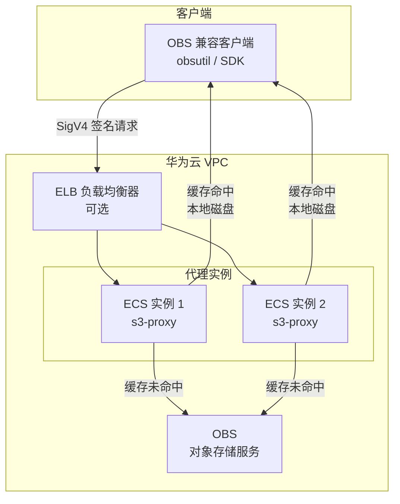

# 架构说明 — sample-s3-hybrid-cache

> 本文档描述 S3 透明缓存代理的整体架构、组件设计、数据流与关键技术决策。

## 1. 系统架构

### 1.1 总体架构

```
┌──────────────────────────────────────────────────────────────────┐
│                          客户端                                    │
│         OBS SDK / obsutil / S3 兼容 CLI (SigV4 签名)          │
└──────────────────────────┬───────────────────────────────────────┘
                           │ HTTPS (80/443)
                           ▼
┌──────────────────────────────────────────────────────────────────┐
│                    S3 透明缓存代理 (ECS)                           │
│  ┌──────────────────────────────────────────────────────────┐   │
│  │  s3-proxy.py (Python HTTP Server)                        │   │
│  │  ├── 认证层: 透传 SigV4 签名（不存储凭据）                 │   │
│  │  ├── 缓存层: 本地磁盘缓存 (MD5 key → JSON 文件)            │   │
│  │  ├── 转发层: 保持 Host 头，URL 重写为 OBS 虚拟主机         │   │
│  │  └── 观测层: /health + /metrics (Prometheus)              │   │
│  └──────────────────────────────────────────────────────────┘   │
│  ┌──────────────────────────────────────────────────────────┐   │
│  │  本地磁盘缓存 (/mnt/cache, 默认 5GB)                      │   │
│  │  生产: SFS Turbo 共享文件存储 (需白名单)                  │   │
│  └──────────────────────────────────────────────────────────┘   │
└──────────────────────────┬───────────────────────────────────────┘
                           │ HTTPS (443)
                           ▼
┌──────────────────────────────────────────────────────────────────┐
│                    OBS 对象存储 (cn-north-4)                      │
│         S3 兼容 REST API + SigV4 签名验证                         │
└──────────────────────────────────────────────────────────────────┘
```

### 1.2 组件清单

| 组件 | 技术选型 | 说明 |
|---|---|---|
| 代理服务 | Python 3 + http.server | 轻量 HTTP 代理，无需额外依赖 |
| 部署 | Terraform + userdata | IaC 一键部署 |
| 服务管理 | systemd | 开机自启 + 崩溃重启 |
| 缓存 | 本地磁盘 (JSON 文件) | 默认 5GB，可替换 SFS Turbo |
| 监控 | /metrics (Prometheus) | 暴露缓存大小等指标 |

## 2. 设计原则

### 2.1 透明代理（核心原则）

代理**不存储任何 OBS 凭据**，仅透传客户端的 SigV4 签名请求：

- 客户端对 OBS 虚拟主机域名签名：`Host: <bucket>.obs.<region>.myhuaweicloud.com`
- 代理收到请求后，仅将 URL 从 `http://<proxy-ip>/<key>` 重写为 `https://<bucket>.obs.<region>.myhuaweicloud.com/<key>`
- **保持 Host 头不变**（这是签名有效的关键）

**为什么保持 Host 头不变？**

OBS 的 SigV4 签名覆盖 `Host` 头。如果代理将 Host 从虚拟主机域名改为代理 IP，OBS 重新计算签名时会发现不匹配，返回 `SignatureDoesNotMatch`。因此代理必须保留客户端原始 Host 头。

### 2.2 无状态架构

- 代理实例之间**无直接通信**
- 缓存独立存储于本地磁盘（或共享 SFS Turbo）
- 支持水平扩展：增加实例数即可提升吞吐量
- 任一实例故障不影响其他实例（通过 ELB 自动摘除）

### 2.3 本地磁盘缓存

- 缓存键：`MD5(method:path)`，如 `GET:/bucket/key`
- 缓存文件：JSON（status + headers + body）
- 仅缓存 HTTP 200 响应
- 容量上限：5GB（默认），超过后停止写入

## 3. 数据流

### 3.1 缓存未命中（首次访问）

```
客户端 → SigV4 签名请求 → 代理
  → 缓存查询: MD5(key) 不存在
  → 转发到 OBS（保持 Host 头）
  → OBS 验证签名 → 返回 200 + 数据
  → 代理写缓存 (JSON 文件)
  → 代理返回 200 + 数据给客户端
```

### 3.2 缓存命中（重复访问）

```
客户端 → SigV4 签名请求 → 代理
  → 缓存查询: MD5(key) 存在
  → 直接返回缓存内容（不回源 OBS）
  → 代理返回 200 + 缓存数据
```

### 3.3 写入操作（PUT/DELETE）

```
客户端 → SigV4 签名 PUT → 代理
  → 转发到 OBS（保持 Host 头）
  → OBS 验证签名 → 写入成功 → 返回 200
  → 代理透传响应（不缓存写操作）
```

## 4. 关键技术决策

### 4.1 实现选型：Rust 完整实现 + Python 轻量验证

本仓库提供两套实现，分别面向不同阶段：

| 维度 | Rust 完整实现 (src/rust) | Python 轻量验证代理 (userdata.sh 内嵌) |
|---|---|---|
| 定位 | 生产级完整功能（流式、范围缓存、压缩、观测） | L1-L5 验证场景的最小 HTTP 代理 |
| 部署复杂度 | 需编译 toolchain 或预编译二进制 | 零依赖（Python 标准库） |
| 启动速度 | 毫秒级 | 秒级 |
| 性能 | 高（大文件流式） | 足够（小文件缓存场景） |
| 依赖 | Cargo 构建 | 无外部依赖 |

**决策**：验证场景使用 userdata.sh 内嵌的 Python 最小代理简化部署；生产高吞吐场景编译 Rust 实现（main.tf 支持 `proxy_binary_url` 下载预编译二进制）。

### 4.2 为什么本地磁盘而非 SFS Turbo？

- **账号限制**：SFS Turbo 需要白名单（`SFS.TURBO.0144`），当前账号未开通
- **简化验证**：L1-L5 验证场景使用本地磁盘即可满足
- **生产建议**：多实例共享缓存时申请 SFS Turbo 白名单，挂载到 `/mnt/cache`

### 4.3 安全组设计

| 端口 | 协议 | 来源 | 用途 |
|---|---|---|---|
| 80 | TCP | 客户端 CIDR | 代理 HTTP |
| 443 | TCP | 客户端 CIDR | 代理 HTTPS（如启用） |
| 22 | TCP | 管理员 IP | SSH 管理 |
| /metrics | TCP | 监控系统 | 指标采集 |

## 5. 服务选型

| 能力 | 华为云服务 | 说明 |
|---|---|---|
| 对象存储 | OBS | S3 兼容接口 + SigV4 签名 |
| 计算 | ECS | 代理实例（userdata 引导部署） |
| 共享缓存 | SFS Turbo（或本地磁盘） | 需账号白名单；验证场景用本地磁盘 |
| 部署 | Terraform | huaweicloud Provider IaC |
| 监控 | CES + Prometheus | /metrics 端点采集 |
| 负载均衡 | ELB | 多实例可选前置 |

> 选型说明：本实践全部基于华为云原生产品（OBS / ECS / SFS Turbo / ELB / CES），客户端通过 OBS 的 S3 兼容接口接入，业务协议（SigV4 签名、S3 API 语义）由 OBS 原生支持。

## 6. 扩展设计

### 6.1 多实例 + ELB

```
客户端 → ELB (L4)
         ├── ECS-1 (s3-proxy, 本地缓存)
         ├── ECS-2 (s3-proxy, 本地缓存)
         └── ECS-3 (s3-proxy, 本地缓存)
                  ↓ 共享缓存 (SFS Turbo)
```

### 6.2 缓存增强

- **LRU 淘汰**：缓存满时淘汰最久未访问对象
- **TTL 过期**：对象更新后自动失效
- **范围缓存**：支持字节范围（Range）请求的缓存
- **Redis 后端**：高并发场景使用 Redis 替代文件缓存

## 7. 架构图（Mermaid）



## 8. 参考文档

- [部署指南](deployment-guide.md)
- [华为云 OBS 文档](https://support.huaweicloud.com/obs/)
- [华为云 ECS 文档](https://support.huaweicloud.com/ecs/)
- [Terraform huaweicloud Provider](https://registry.terraform.io/providers/huaweicloud/huaweicloud/1.94.0)
